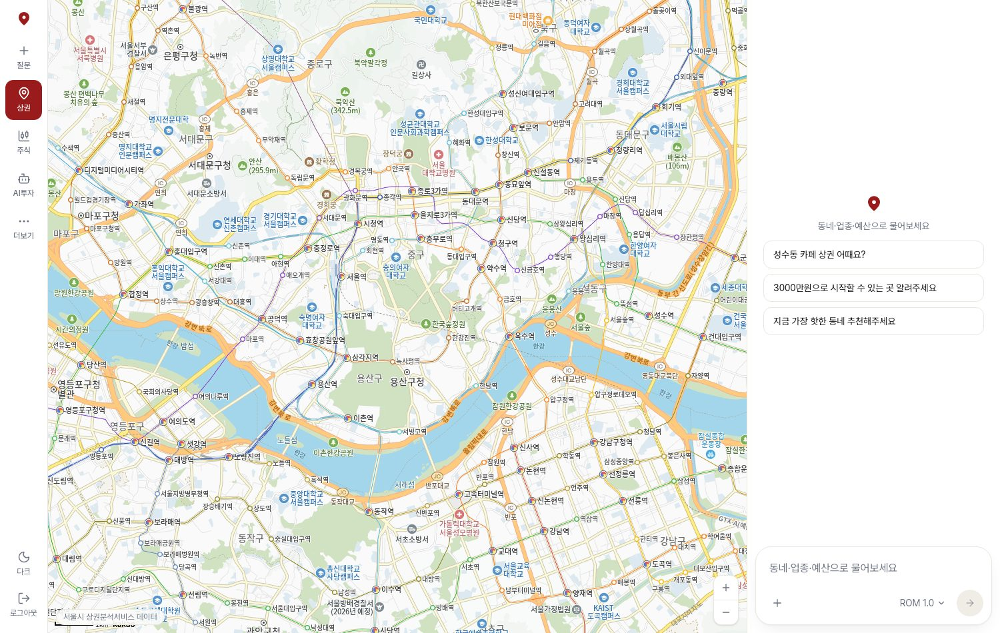
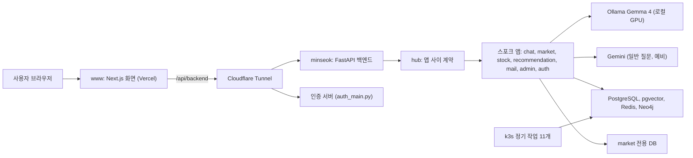

# RedOceanMap

서울에서 창업할 곳을 찾는 사람과 주식 투자자가 질문하면, 서울시 상권 공공데이터와 주가, 뉴스를 근거로 답하는 대화형 서비스입니다.

[포트폴리오 소개 페이지](https://redoceanmap.jangminseok.com) | 상태: 운영 종료(2026-10-26) | [](https://github.com/jangminseok-dev/com.redoceanmap/actions/workflows/ci.yml)

2026년 5월부터 약 5개월 동안 교육 과정의 자체 서버에서 운영했고, 과정이 끝난 2026년 10월 26일 서버를 내렸습니다. 지금은 서비스 주소에 들어가도 답을 받을 수 없으니, 화면과 동작은 포트폴리오 소개 페이지에서 보실 수 있습니다.



## 한눈에 보기

| 항목 | 내용 |
| --- | --- |
| 기간 | 개발 2026-05-22 ~ 2026-10-06 (main의 첫 커밋과 마지막 커밋), 운영 2026-05 ~ 2026-10-26 |
| 인원과 역할 | 1인 개발. 기획, 백엔드, 화면, 인프라, AI 답변 품질 평가, 운영을 모두 맡았습니다 |
| 상태 | 운영 종료(2026-10-26, 교육 과정 서버 종료). 클라우드 이전을 검토하고 있습니다 |
| 주요 기술 | Python 3.11, FastAPI, PostgreSQL과 pgvector, Ollama(Gemma 4), Gemini, Next.js 16, k3s |
| 규모 | 커밋 457개, 백엔드 테스트 파일 182개 (2026-10-06 기준) |


## 주요 기능

- **대화로 묻는 상권 분석**: "성수동 카페 상권 어때요?"처럼 물으면 서울시 상권 데이터에서 매출, 유동인구, 폐업률을 찾아 답합니다. 숫자가 들어간 문장에는 근거 번호를 붙이고, 점수가 낮은 상권이면 첫 문단에서 주의 등급임을 먼저 알립니다.
- **상권 지도와 비교표**: 지도에서 상권을 살피면서 옆 대화창에 바로 물을 수 있습니다. 이어서 "길음역과 비교해 줘"라고 하면 최대 4곳을 한 표로 비교합니다. 표와 결론은 코드가 계산합니다.
- **창업 자금 계산**: "내 돈 1억이면 몇 개월 버티나"처럼 물으면 버틸 수 있는 기간과 모자라는 돈을 계산합니다. 임대료는 한국부동산원, 금리는 한국은행 자료를 씁니다.
- **종목 분석과 신호 보드**: 한국과 미국 종목의 시세, 지표, 뉴스를 모아 설명하고, 앞으로 5거래일의 상승 또는 하락 신호를 지난 적중률과 함께 보여 줍니다. 매매를 권하지 않습니다.
- **가격 도달과 뉴스 알림**: 정해 둔 가격에 닿거나 관심 종목에 강한 뉴스가 나오면 이메일이나 텔레그램으로 알립니다.
- **AI 모의투자와 유해 메일 거르기**: AI 계정과 지표 규칙 계정이 가상의 1억 원으로 매매한 기록을 공개합니다. 서비스 메일함에 들어온 메일은 직접 학습시킨 분류 모델(KcELECTRA)이 혐오 표현을 먼저 거릅니다.

## 구조



화면은 Vercel에 올렸고, 백엔드와 인증 서버, 정기 작업은 자체 Ubuntu 서버의 k3s에서 돌렸습니다. 데이터베이스는 Docker Compose에 따로 두었습니다. 백엔드는 앱 8개(허브 1개와 스포크 7개)로 나뉜 모듈러 모놀리식이며, 스포크끼리는 서로를 직접 부르지 못하고 허브의 계약을 거쳐야 합니다. 상권과 주식 답변은 8GB GPU에서 도는 로컬 모델이 쓰고, 주제를 벗어난 일반 질문과 예비 경로에만 Gemini를 씁니다.

질문은 먼저 네 갈래(상권, 주식, 상권 뉴스, 일반)로 나뉩니다. 각 단계 사이에서는 코드로 만든 규칙 가드가 서울 밖 지역 질문을 막고, 숫자와 금지 표현을 다시 확인합니다. 이전 README의 상세 도식과 기술 표는 [_docs/ARCHITECTURE.md](_docs/ARCHITECTURE.md)로 옮겼습니다.

## AI와 함께 만든 방식

Claude Code와 함께 만들었습니다. main의 커밋 457개 가운데 448개에 Claude 공동 작성자 표기가 있습니다(`git log --grep='Co-Authored-By: Claude'`로 센 값).

**규칙 문서로 에이전트를 묶었습니다.** 루트 [CLAUDE.md](CLAUDE.md)와 영역별 CLAUDE.md 10개(백엔드, 각 앱, 화면)가 에이전트가 먼저 읽을 규칙을 정합니다. 예를 들어 스포크끼리 직접 import하지 않기, 공유 DB와 market 전용 DB를 섞지 않기, 볼륨 삭제처럼 되돌릴 수 없는 명령은 사람 확인 뒤에만 실행하기, 비밀값을 로그와 커밋에 남기지 않기가 들어 있습니다. 검증 명령도 적어 두었는데, `npx tsc`가 엉뚱한 패키지를 받아 성공으로 끝나는 일이 있어 반드시 `pnpm run typecheck`를 쓰라는 규칙도 있습니다.

**검증 명령을 에이전트 도구로 만들었습니다.** 테스트, 아키텍처 검사, 타입 검사를 도커로 돌리는 긴 명령을 에이전트가 바로 부를 수 있게 MCP 서버([minseok/scripts/mcp_server.py](minseok/scripts/mcp_server.py), 커밋 c41800e)로 감쌌습니다.

**문서를 먼저 쓰고 구현했습니다.** `_docs` 폴더에 Markdown 문서 77개(규칙, 설계, 계획, 평가, QA 보고서)가 있습니다. k3s 전환과 창업 재무 엔진 두 작업은 설계 문서, 단계별 체크박스가 달린 구현 계획, 구현, 검증 기록 순서로 남아 있습니다([설계](_docs/k3s-migration-2026-09.md), [계획](_docs/k3s-migration-2026-09-plan.md)). [로드맵](minseok/_docs/ROADMAP.md)에는 마일스톤마다 검증 결과를 함께 적었습니다.

**방향은 사람이 정했습니다.** 커밋 8개에 "사용자 결정"이 적혀 있습니다. 예를 들어 CI는 1인 개발 단계에서는 필요 없다고 보고 한 번 껐다가(e501920, 2026-07-13), 수동 검증을 빠뜨릴 수 있어 다시 켰습니다(0563139, 2026-10-06). 사용자가 적은 모의투자에서 사람 참가를 빼기로 한 것(6554c0b)도 같은 방식으로 정했습니다.

## 검증

AI가 쓴 코드는 사람이 한 줄씩 읽는 대신, 아래 장치들의 결과로 확인했습니다.

| 장치 | 확인하는 것 |
| --- | --- |
| 백엔드 테스트 (pytest, 파일 182개) | 기능 동작. 로컬 모델이나 외부 API를 부르는 테스트는 `ollama`, `network` 표시로 기본 실행에서 뺍니다 |
| import-linter 계약 5개 ([minseok/.importlinter](minseok/.importlinter)) | 앱 안의 계층 방향, 스포크끼리의 독립, 도메인 코드가 프레임워크에 기대지 않는지, 허브가 스포크를 모르는지 |
| GitHub Actions ([ci.yml](.github/workflows/ci.yml)) | main에 올릴 때마다 위 두 가지와 빈 DB 두 개에 마이그레이션을 끝까지 적용해 보는 검사 |
| 답변 골든셋 ([EVAL.md](minseok/apps/chat/_docs/EVAL.md)) | 정답과 채점 기준을 정해 둔 질문 149개(현재 파일 기준). 실제 모델로 답을 기록하고, 규칙으로 채점하고, 기준선보다 나빠지면 실패시킵니다. AI 채점은 쓰지 않습니다 |
| 검색 골든셋 | 질문 40개와 공시 질문 20개로 검색 품질(nDCG, recall)을 채점합니다 |
| 페르소나 QA ([보고서](_docs/QA_PERSONA_2026-09.md)) | 가상 사용자 10명을 에이전트가 하나씩 맡아 실제 서비스에서 가입부터 목적 달성까지 걸어 봤습니다(2026-09-08) |
| 화면 타입 검사 | `pnpm run typecheck`. 화면에는 테스트 러너가 없습니다 |

측정해 둔 결과입니다.

- 골든셋 144문항 실행에서 오류 0건, 숫자가 들어간 문장 중 근거 번호가 달린 비율 0.987 ([FINANCE_ENGINE_2026-09-16.md](minseok/_docs/FINANCE_ENGINE_2026-09-16.md))
- 검색 모델을 바꾸면서 검색 품질 점수(nDCG@5)가 0.743에서 0.878로 올랐습니다. 하이브리드 검색은 미리 정한 기준(+0.03)에 못 미쳐(+0.018) 넣지 않았습니다 ([LLM_SWAP_EVAL_2026-09-14.md](minseok/_docs/LLM_SWAP_EVAL_2026-09-14.md), [RETRIEVAL_EVAL_2026-08.md](minseok/_docs/RETRIEVAL_EVAL_2026-08.md))
- 상권 최신 자료 조회는 인덱스를 다시 설계해 2.2ms에서 0.065ms로, 상권 점수 조회는 저장값을 쓰게 해 330ms에서 12.4ms로 줄었습니다 ([market CLAUDE.md](minseok/apps/market/_docs/CLAUDE.md))
- 상권 종합점수 첫 판은 지난 자료로 다시 계산해 예측력을 시험했습니다. 우수 등급의 다음 분기 상대 유동인구 증가가 평균 +5.07%p였지만 세부 요소의 예측력은 약해 "예측기가 아니라 현황 요약"이라고 한계를 적었고, 2026-09-17에 향후 1년 폐업률을 기준으로 점수를 다시 설계했습니다 (같은 문서)

이 장치들이 실제로 잡은 문제입니다.

- **3ab4e13**: 프롬프트에 열 하나를 더하자 Ollama 기본 컨텍스트 창(4,096토큰)을 넘어 앞부분의 형식 지시가 잘렸습니다. 상권 코드 반환이 40건 중 40건에서 44건 중 0건이 됐는데, 지역 가드가 대신 채워 주는 바람에 지역 적중률 지표는 1.0으로 정상처럼 보였습니다. 창을 8,192로 명시하고, 한도의 90%를 넘으면 경고를 남기게 했습니다.
- **7c0d401**: 페르소나 QA에서 "삼성전자 지금 사도 돼?"가 500 오류를 냈습니다. 한국 종목 목록을 주는 외부 주소가 404를 내고 있었습니다. 대형주 30종목 예비 표로 대신하게 하고 회귀 테스트를 더했습니다.
- **a18d3a9**: 실제 대화에서 종목 비교를 물었는데 직전에 추천한 상권을 비교했고, 같은 비교의 결론이 1분 사이에 뒤집혔습니다. 비교 대상을 가리는 라우팅 가드를 넣고, 우열 판정을 없앴습니다.

## 시작하기

준비물은 Docker(맥은 colima, k3s 포함), kubectl, Node.js와 pnpm입니다. 호스트에 파이썬 개발 환경이 없다는 전제라 백엔드 검증은 도커로 돌립니다. 환경 변수는 [.env.example](.env.example)을 복사해 채웁니다.

```bash
cd infra && docker compose up -d pgvector redis      # 데이터베이스(도커)
infra/k8s/secrets.sh redocean-dev && infra/k8s/load-image.sh dev
kubectl apply -k infra/k8s/overlays/dev-mac          # 백엔드와 인증 서버(k3s)
cd minseok/apps/market && docker compose up -d       # market 전용 DB(:5434, 선택)
cd www && pnpm install && pnpm run dev               # 화면(:3000), NEXT_PUBLIC_API_URL=http://192.168.64.2:18000
```

k3s 설치, 배포, 되돌리기 절차는 [infra/k8s/README.md](infra/k8s/README.md)에 있습니다.

```bash
# 백엔드 테스트
docker run --rm -v $PWD:/work -w /work -e PYTHONPATH=/work/minseok:/work/minseok/apps \
  minseok97/redoceanmap-backend:latest python -m pytest minseok/apps -q -m "not ollama and not network"
# 아키텍처 계약 5개
docker run --rm -v $PWD:/work -w /work/minseok -e PYTHONPATH=apps \
  minseok97/redoceanmap-backend:latest lint-imports --config .importlinter
# 화면 타입 검사
cd www && pnpm run typecheck
```

Python 3.11과 `minseok/requirements.txt`가 있는 환경에서는 CI와 같은 명령을 `minseok/`에서 바로 돌릴 수 있습니다.

```bash
cd minseok
PYTHONPATH=apps lint-imports --config .importlinter
PYTHONPATH=.:apps pytest apps tests -q -p no:cacheprovider -m "not network and not ollama"
```

## 폴더 구조

| 폴더 | 내용 |
| --- | --- |
| `minseok/` | FastAPI 백엔드. `main.py`(백엔드), `auth_main.py`(인증 서버), `core/`(설정, LLM 연결), `scripts/`(수집, 백업, 점검) |
| `minseok/apps/` | 앱 8개. hub, chat, market, stock, recommendation, mail, admin, auth. 앱마다 `adapter`, `app`, `domain`, `tests`, `_docs` |
| `www/` | Next.js 화면 |
| `infra/` | Docker Compose 파일, 배포 스크립트, k3s 설정(`k8s/`)과 정기 작업 |
| `flutter/` | 모바일 앱과 실기기 테스트 문서 |
| `blog/` | 프로젝트 기록용 Jekyll 블로그 |
| `_docs/` | 저장소 전체 문서(설계, 계획, QA 보고서) |
| `.github/workflows/` | CI |

## 문서

| 문서 | 내용 |
| --- | --- |
| [CLAUDE.md](CLAUDE.md) | 에이전트 규칙. 경계, 검증 명령, 작업 범위 |
| [_docs/ARCHITECTURE.md](_docs/ARCHITECTURE.md) | 이전 README의 구조 도식, 대화 파이프라인, 기술 표 |
| [_docs/harness.md](_docs/harness.md) | import-linter와 문서 구조 검증 |
| [minseok/_docs/CLAUDE.md](minseok/_docs/CLAUDE.md) | 백엔드 규칙과 앱 지도 |
| [minseok/_docs/ROADMAP.md](minseok/_docs/ROADMAP.md) | 단계별 로드맵과 마일스톤별 검증 기록 |
| [minseok/apps/chat/_docs/EVAL.md](minseok/apps/chat/_docs/EVAL.md) | 답변 품질 평가. 골든셋, 러너, 게이트 |
| [minseok/apps/market/_docs/MARKET_ERD.md](minseok/apps/market/_docs/MARKET_ERD.md) | 상권 DB 스키마(차원 5개, 팩트 9개) |
| [minseok/_docs/LANGGRAPH_QLORA_DEFERRAL_2026-10.md](minseok/_docs/LANGGRAPH_QLORA_DEFERRAL_2026-10.md) | 측정 뒤 도입을 보류한 기술 기록 |
| [_docs/k3s-migration-2026-09.md](_docs/k3s-migration-2026-09.md) | k3s 전환 설계 |
